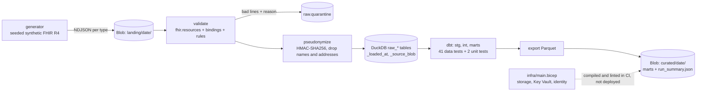
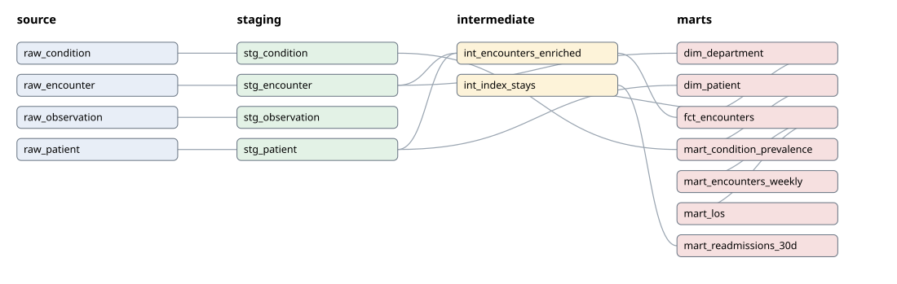

# fhir-analytics-pipeline

A batch analytics pipeline for clinical data in HL7 FHIR R4 format. All data is synthetic.

Airflow runs a daily DAG. It reads FHIR bulk-export files (NDJSON) from Azure Blob Storage (the Azurite emulator), validates each record, pseudonymizes patient identifiers, loads raw tables into DuckDB, runs dbt models and tests, and publishes curated Parquet marts back to Blob Storage. The target Azure resources are described in Bicep, which CI compiles and lints.

The marts answer four operations questions: encounters per department per week, 30-day readmission rate, length of stay, and condition prevalence.



dbt lineage (generated from `manifest.json` by `scripts/lineage_svg.py`):



## What this is not

- The data is synthetic, from my own generator. It is not Synthea output and not real patient data.
- It handles four FHIR resource types only: Patient, Encounter, Condition, Observation. There is no FHIR server, no SMART on FHIR, no HL7 v2 and no EHR vendor integration.
- Pseudonymization is a design demo. The project does not claim HIPAA compliance. See `SECURITY.md`.
- DuckDB stands in for a cloud warehouse. There is no Snowflake, BigQuery or Databricks.
- Azure is used only through the Blob Storage SDK against the Azurite emulator, and through Bicep that is compiled and linted. Nothing is deployed to an Azure subscription. No Data Factory, Synapse, AKS or other Azure service is used.
- Airflow runs on a single machine. Tests use `dag.test()`. A scheduler and web server were not run for this project.
- Validation uses the R4B models of `fhir.resources` (FHIR 4.3.0) plus a short table of required code bindings. It does not use profiles such as US Core and does not check terminology servers.
- The incremental model skips an update that is older than the newest row already loaded (see `docs/DECISIONS.md`, entry 6).

## Results (real, recorded 2026-11-07 on one laptop)

| Check | Result |
|---|---|
| pytest (all) | 41 passed in 158 s |
| dbt build on 1,000 patients | 56 nodes: 13 models, 41 data tests, 2 unit tests, all pass |
| Hand-written readmission fixture | 9 index stays, 3 readmissions, matches `mart_readmissions_30d` exactly |
| Incremental model | second run on the same data changes no row; an update batch changes only the 2 touched rows |
| DAG end to end, 1,000 patients (6,038 resources) | 98.9 s, 51 quarantined, all marts published |
| DAG end to end, 10,000 patients (60,413 resources) | 130.1 s, dbt 4.5 s, 501 quarantined (`docs/PERF.md`) |
| Bicep | build and lint with 0 warnings, ARM policy test passes |
| ruff, mypy (strict), sqlfluff | clean |

CI status: the workflow in `.github/workflows/ci.yml` has five jobs (`lint`, `unit`, `dbt`, `airflow-e2e`, `bicep`). It has not run on GitHub yet, because the repository has not been pushed. I ran the same commands for each job locally. Do not treat the project as CI-verified until the jobs are green on `main`.

## Quick start

```bash
python3.12 -m venv .venv && .venv/bin/pip install -r requirements/base.txt -c requirements/airflow-constraints.txt && .venv/bin/pip install -e . --no-deps
python3.12 -m venv .venv-dbt && .venv-dbt/bin/pip install -r requirements/dbt.txt
eval "$(scripts/azurite.sh start)"
export DBT_BIN=$PWD/.venv-dbt/bin/dbt FHIR_HMAC_KEY=local-demo-key-not-a-secret
.venv/bin/python scripts/run_dag_test.py --patients 1000 --workdir .work/demo
.venv/bin/pytest -q
scripts/azurite.sh stop
```

Details: `docs/ONBOARDING.md`.

## Layout

| Path | Content |
|---|---|
| `generator/` | Seeded synthetic FHIR generator with deliberate defects |
| `src/fhir_pipeline/` | Validator, pseudonymizer, Blob client, DuckDB loader, pipeline steps |
| `dags/fhir_daily.py` | The Airflow DAG |
| `dbt/fhir_analytics/` | dbt project: staging, intermediate, marts, tests, unit tests |
| `infra/` | Bicep template and parameter files (compiled and linted only) |
| `tests/` | pytest suites and hand-written fixtures |
| `scripts/` | Azurite helper, end-to-end runner, Bicep check, lineage drawing |
| `docs/` | `ONBOARDING.md`, `RUNBOOK.md`, `DEMO.md`, `DECISIONS.md`, `PERF.md` |
| `LEARN.md` | Plain-language guide and interview notes |

## Data quality gates

1. Per line: JSON parse, FHIR model, required code bindings, business rules. Rejects go to `raw.quarantine` with a reason.
2. Before load: pseudonymization. A test asserts that no name or address field survives.
3. In dbt: `unique`, `not_null`, `relationships`, `accepted_values`, two singular tests, and two unit tests with hand-computed answers. A failing test stops the run.

## License

MIT. Copyright Stanley Sujith Nelavala.
