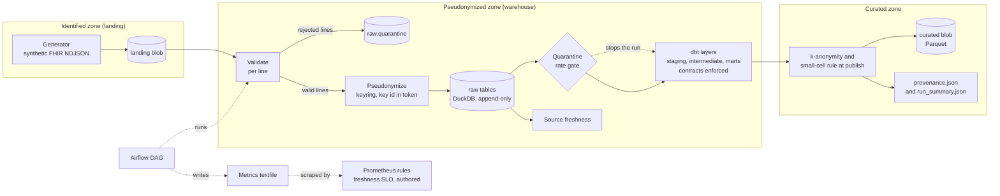

# Architecture

All data is synthetic. The cloud parts run on the Azurite emulator or are written as Bicep only.

## Data flow

## Components

| Component | Where | What it does |
|---|---|---|
| Generator | `generator/generate_fhir.py` | Writes seeded synthetic FHIR R4 NDJSON, with some bad lines on purpose |
| Landing blob | `src/fhir_pipeline/blob.py` | Holds raw files by run date. Azurite here, a storage account in the Bicep file |
| Validate | `src/fhir_pipeline/validate.py` | Checks each line. A bad line goes to quarantine with a reason |
| Pseudonymize | `src/fhir_pipeline/pseudonymize.py` | Drops direct identifiers. Ids become tokens with a key id |
| Raw tables | `src/fhir_pipeline/warehouse.py` | DuckDB tables. Append-only. A load log blocks a second load of a blob |
| Gates | `src/fhir_pipeline/pipeline.py` | Quarantine-rate limit and dbt source freshness |
| dbt project | `dbt/fhir_analytics/` | Staging, intermediate and mart models. Contracts on all marts |
| k-anonymity | `src/fhir_pipeline/kanon.py` | Groups under k are generalized or dropped before the curated file |
| Provenance | `src/fhir_pipeline/provenance.py` | One manifest per run: input hashes, code SHA, dbt manifest hash, row counts |
| Metrics | `src/fhir_pipeline/metrics.py` | Textfile for Prometheus |
| DAG | `dags/fhir_daily.py` | Runs the steps in order. Resource groups run one after another |
| Bicep | `infra/main.bicep` | Describes the Azure target. Compiled and linted, never deployed |

## Trust zones

| Zone | Holds | Who should read it |
|---|---|---|
| Identified | Landing blobs with source ids, names and addresses | A small trusted group and the pipeline identity |
| Pseudonymized | Raw tables, quarantine, dbt models | The data team |
| Curated | k-anonymous Parquet marts, manifest, summary | Analysts and the quality office |

The quarantine table keeps the raw text of rejected lines. So it sits in the same zone as the landing blobs in terms of risk. This repo does not yet separate the two.

## Decisions

The design decisions are in `docs/DECISIONS.md`. The risk decision for read access is in `docs/engagement/RISK-DECISION.md`.
